 

## About

I build AI systems and security tooling: computer vision, efficient multimodal inference, threat detection, robotics simulation and explainable ML. I care about the part after the demo, which means measuring the result and being able to explain why the system made its decision.

|  |  |
|:--|:--|
| **Currently building** | [ARGUS](https://github.com/satyamshrivastav955-dotcom/ai-surveillance), an offline video-intelligence system |
| **Researching** | Token pruning and quantized KV-cache for long-context video VLMs |
| **Experience** | ML Engineer Intern at Softron and SkillOrbit |
| **Focus** | Edge AI, computer vision, cybersecurity, robotics |

## GitHub at a Glance

&nbsp;

 

&nbsp;

## Contribution Snake

## Detailed Profile Breakdown

 

&nbsp;

 

&nbsp;

## Trophies

## Tech Stack

<table>
  <tr>
    <td width="170"><b>Languages</b></td>
    <td></td>
  </tr>
  <tr>
    <td><b>AI / ML / Vision</b></td>
    <td></td>
  </tr>
  <tr>
    <td><b>Backend</b></td>
    <td></td>
  </tr>
  <tr>
    <td><b>Frontend and mobile</b></td>
    <td></td>
  </tr>
  <tr>
    <td><b>Data</b></td>
    <td></td>
  </tr>
  <tr>
    <td><b>Cloud and tooling</b></td>
    <td></td>
  </tr>
</table>

## Selected Work

| Project | What it does | Stack |
|:--|:--|:--|
| [**ARGUS**](https://github.com/satyamshrivastav955-dotcom/ai-surveillance) | Offline video intelligence: detection, tracking, pose events and a quantized VLM that describes the scene, with local alerting | YOLO, ByteTrack, Qwen2.5-VL |
| [**CallShield**](https://github.com/satyamshrivastav955-dotcom/call-shield) | Scam and impersonation defense that fuses voice, speaker and language signals into an explainable risk summary | LangGraph, PyTorch |
| [**GraphQL-Sentinel**](https://github.com/satyamshrivastav955-dotcom/GraphQL-Sentinel) | Runtime GraphQL security gateway that explains why a request was blocked | React, policy engine |
| [**Hybrid AI NIDS**](https://github.com/satyamshrivastav955-dotcom/hybrid-ai-nids) | Network intrusion detection from four fused models with drift monitoring and a SOC dashboard | FastAPI, React, CICIDS2017 |
| [**Language-to-Action Robot Agent**](https://github.com/satyamshrivastav955-dotcom/language-to-action-robot-agent) | LLM plans a 6-DOF arm task, then a verifier checks the real result and retries from measured error | MuJoCo, local LLM |
| [**Face Blockchain Verification**](https://github.com/satyamshrivastav955-dotcom/face-blockchain-verification) | Tamper-evident image provenance with evidence hashes anchored on-chain | Solidity, SFace, Base Sepolia |
| [**TaskOrbit**](https://github.com/satyamshrivastav955-dotcom/taskorbit) | Role-aware project delivery workspace with kanban, revisions and versioned deliverables | React, TypeScript, Firebase |
| [**Student Performance Intelligence**](https://github.com/satyamshrivastav955-dotcom/student-performance-prediction-system) | Explainable academic risk prediction with SHAP, counterfactuals and fairness auditing | scikit-learn, Streamlit |

## Achievements

**Hackathons**

- 1st Prize, CIH '26 ([certificate](https://drive.google.com/file/d/1KW87fImSL8dOjaUJ3tnHc7Kyc8yd2RjC/view?usp=drivesdk))
- 1st Prize, Ikigai '26 ([certificate](https://drive.google.com/file/d/1kkbnJ9a_QX_yv_RIxcPlnHo5NdlzvIFh/view?usp=drivesdk))
- Participant: [ISRO Hackathon](https://drive.google.com/file/d/1eT8dYOiQXQpE1k18L4o27QT0RDdXfowy/view?usp=drivesdk), [Vicodathon '26](https://drive.google.com/file/d/16KtNEjSGa-_6sa3wxCtL9bOuOhI6gUF_/view?usp=drivesdk), [ET AI](https://drive.google.com/file/d/1BuB1R4h0bGT10-hZjUG3HTgmNrQdNmpH/view?usp=drivesdk), [StudAI](https://drive.google.com/file/d/1wnBBS0csNmgErU8fvhxzcZLhb9mfUzfB/view?usp=drivesdk), [InnovaHack 2026](https://drive.google.com/file/d/1_dsa2roFZOKkklzkFmsisiSkdqACwhjJ/view?usp=drivesdk)

**Publications**

- [NASA journal paper](https://drive.google.com/file/d/1UCG-AVRCVX-AOmXhCsDqAuGT0EToVZ4q/view?usp=drivesdk)
- [GraphQL AI security, ICNGCIS25](https://drive.google.com/file/d/1HHzw4yg203f52CLRhzghn-iNG5n5Hgp1/view?usp=drivesdk)
- [MediSmart, ICETMIS25](https://drive.google.com/file/d/1v-jaZ8d4oVey-okqdeLjXFkMbgsP6hMc/view?usp=drivesdk)
- [Finance OCR, ICAST](https://drive.google.com/file/d/1A-WLiySdA7d8sr7Dt-2lvzNYS8FxyJZa/view?usp=drivesdk)

**Experience and credentials**

- ML Engineer Intern, [Softron Kolhapur](https://drive.google.com/file/d/1hVqqxFKyz78kqeRAUqONeqq7_xRw_KJU/view?usp=drivesdk)
- ML Intern, [SkillOrbit](https://drive.google.com/file/d/13XaB0prLLaKA5wOFmGm0JNPkOV1Gc7Mb/view?usp=drivesdk), plus [ML Specialization](https://drive.google.com/file/d/17hN_neLrXRqwfIPHAnCHWnbJ1y4DcpXh/view?usp=drivesdk)
- [AWS Cloud Technology Consultant](https://drive.google.com/file/d/1tNOxzJV-CIR7rDxigZ8g3LmJj1oA4nD0/view?usp=drivesdk) and [Fintech Innovations Consultant](https://drive.google.com/file/d/1yUuuT_VlAogilsSrhRqEZpdhsgIOkQ4n/view?usp=drivesdk)

## Dev Quote of the Day

## 📫 Connect With Me

 

 

⭐️ From [Satyam Shrivastav](https://github.com/satyamshrivastav955-dotcom) — *thanks for stopping by!*

