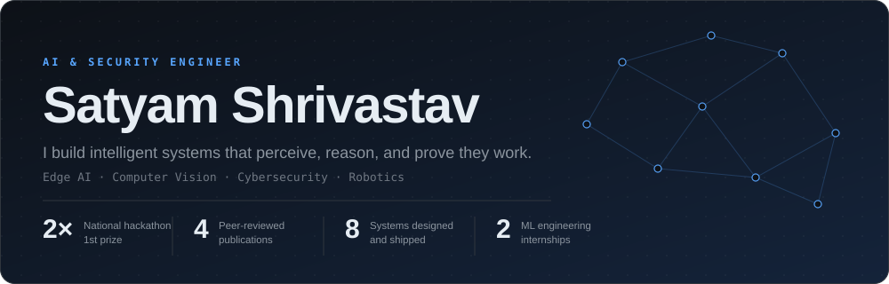

I build AI systems and security tooling: computer vision, efficient multimodal inference, threat detection, robotics simulation and explainable ML. I care about the part after the demo, which means measuring the result and being able to explain why the system made its decision.

|  |  |
|:--|:--|
| 🔭 **Currently building** | [ARGUS](https://github.com/satyamshrivastav955-dotcom/ai-surveillance), an offline video-intelligence system |
| 🔬 **Researching** | Token pruning and quantized KV-cache for long-context video VLMs |
| 💼 **Experience** | ML Engineer Intern at Softron and SkillOrbit |
| 🎯 **Focus** | Edge AI, computer vision, cybersecurity, robotics |

&nbsp;

 

&nbsp;

 

&nbsp;

 

&nbsp;

<table>
  <tr>
    <td width="170"><b>Languages</b></td>
    <td></td>
  </tr>
  <tr>
    <td><b>AI / ML / Vision</b></td>
    <td></td>
  </tr>
  <tr>
    <td><b>Backend</b></td>
    <td></td>
  </tr>
  <tr>
    <td><b>Frontend and mobile</b></td>
    <td></td>
  </tr>
  <tr>
    <td><b>Data</b></td>
    <td></td>
  </tr>
  <tr>
    <td><b>Cloud and tooling</b></td>
    <td></td>
  </tr>
</table>

<a href="https://github.com/satyamshrivastav955-dotcom/ai-surveillance">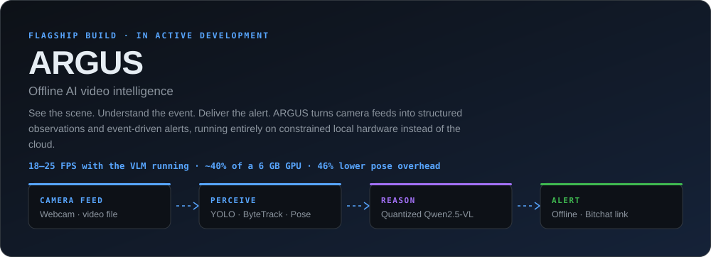</a>

<table>
  <tr>
    <td width="50%"><a href="https://github.com/satyamshrivastav955-dotcom/call-shield">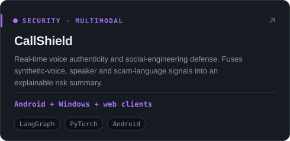</a></td>
    <td width="50%"><a href="https://github.com/satyamshrivastav955-dotcom/graphql-demand-control-gateway">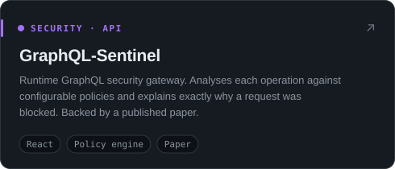</a></td>
  </tr>
  <tr>
    <td width="50%"><a href="https://github.com/satyamshrivastav955-dotcom/hybrid-ai-nids">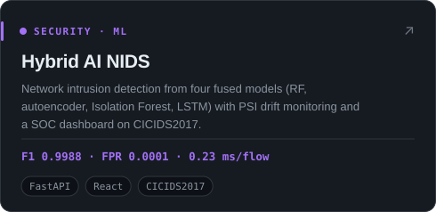</a></td>
    <td width="50%"><a href="https://github.com/satyamshrivastav955-dotcom/language-to-action-robot-agent">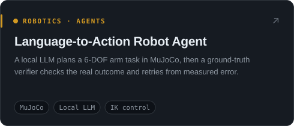</a></td>
  </tr>
  <tr>
    <td width="50%"><a href="https://github.com/satyamshrivastav955-dotcom/face-blockchain-verification">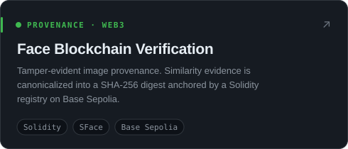</a></td>
    <td width="50%"><a href="https://github.com/satyamshrivastav955-dotcom/locus-x">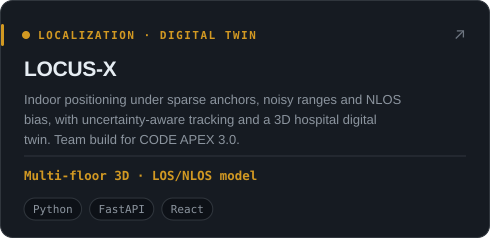</a></td>
  </tr>
  <tr>
    <td width="50%"><a href="https://github.com/satyamshrivastav955-dotcom/reprocheck">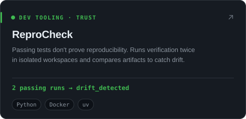</a></td>
    <td width="50%"><a href="https://github.com/satyamshrivastav955-dotcom/taskorbit">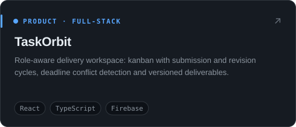</a></td>
  </tr>
  <tr>
    <td width="50%"><a href="https://github.com/satyamshrivastav955-dotcom/student-performance-prediction-system">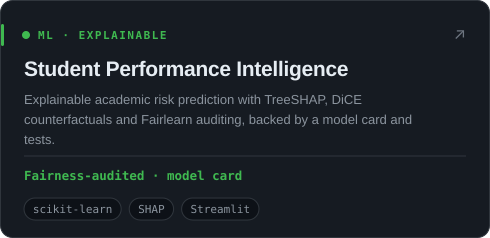</a></td>
    <td width="50%"><a href="https://github.com/satyamshrivastav955-dotcom/argus-vlm-optimization">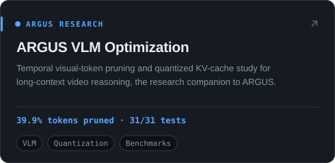</a></td>
  </tr>
</table>

Everything else is on <a href="https://github.com/satyamshrivastav955-dotcom?tab=repositories">my repositories page</a>.

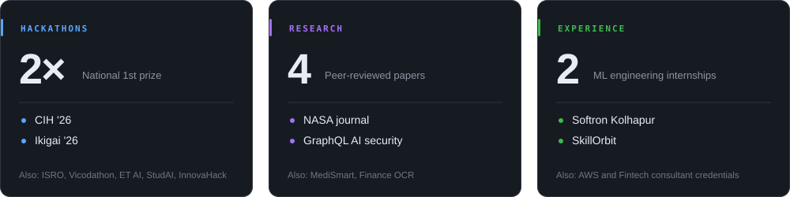

<b>Credentials:</b>
<a href="https://drive.google.com/file/d/1KW87fImSL8dOjaUJ3tnHc7Kyc8yd2RjC/view?usp=drivesdk">CIH '26</a> ·
<a href="https://drive.google.com/file/d/1kkbnJ9a_QX_yv_RIxcPlnHo5NdlzvIFh/view?usp=drivesdk">Ikigai '26</a> ·
<a href="https://drive.google.com/file/d/1eT8dYOiQXQpE1k18L4o27QT0RDdXfowy/view?usp=drivesdk">ISRO</a> ·
<a href="https://drive.google.com/file/d/16KtNEjSGa-_6sa3wxCtL9bOuOhI6gUF_/view?usp=drivesdk">Vicodathon</a> ·
<a href="https://drive.google.com/file/d/1BuB1R4h0bGT10-hZjUG3HTgmNrQdNmpH/view?usp=drivesdk">ET AI</a> ·
<a href="https://drive.google.com/file/d/1wnBBS0csNmgErU8fvhxzcZLhb9mfUzfB/view?usp=drivesdk">StudAI</a> ·
<a href="https://drive.google.com/file/d/1_dsa2roFZOKkklzkFmsisiSkdqACwhjJ/view?usp=drivesdk">InnovaHack</a> 
<b>Papers:</b>
<a href="https://drive.google.com/file/d/1UCG-AVRCVX-AOmXhCsDqAuGT0EToVZ4q/view?usp=drivesdk">NASA journal</a> ·
<a href="https://drive.google.com/file/d/1HHzw4yg203f52CLRhzghn-iNG5n5Hgp1/view?usp=drivesdk">GraphQL AI, ICNGCIS25</a> ·
<a href="https://drive.google.com/file/d/1v-jaZ8d4oVey-okqdeLjXFkMbgsP6hMc/view?usp=drivesdk">MediSmart, ICETMIS25</a> ·
<a href="https://drive.google.com/file/d/1A-WLiySdA7d8sr7Dt-2lvzNYS8FxyJZa/view?usp=drivesdk">Finance OCR, ICAST</a> 
<b>Experience:</b>
<a href="https://drive.google.com/file/d/1hVqqxFKyz78kqeRAUqONeqq7_xRw_KJU/view?usp=drivesdk">Softron</a> ·
<a href="https://drive.google.com/file/d/13XaB0prLLaKA5wOFmGm0JNPkOV1Gc7Mb/view?usp=drivesdk">SkillOrbit</a> ·
<a href="https://drive.google.com/file/d/17hN_neLrXRqwfIPHAnCHWnbJ1y4DcpXh/view?usp=drivesdk">ML Specialization</a> ·
<a href="https://drive.google.com/file/d/1tNOxzJV-CIR7rDxigZ8g3LmJj1oA4nD0/view?usp=drivesdk">AWS</a> ·
<a href="https://drive.google.com/file/d/1yUuuT_VlAogilsSrhRqEZpdhsgIOkQ4n/view?usp=drivesdk">Fintech</a>

## 📫 Connect With Me

 

 

⭐️ From [Satyam Shrivastav](https://github.com/satyamshrivastav955-dotcom) — *thanks for stopping by!*

